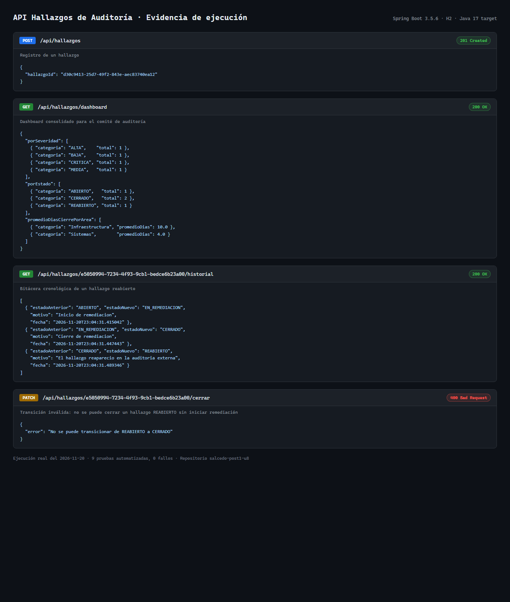

# Post-contenido — Unidad 8: Patrones Arquitectónicos II

**Clean Architecture + análisis costo-beneficio de CQRS/Event Sourcing**

Sistema de seguimiento de hallazgos de auditoría interna implementado con Clean Architecture
(Parte 1) y extendido con un dashboard agregado y una bitácora de trazabilidad (Parte 2),
sobre un único proyecto Spring Boot.

> **Nombre del repositorio:** el proyecto se organizó como `salcedo-post1-u8`, siguiendo
> la convención `apellido-post1-u8` exigida por la actividad. Si el apellido del estudiante
> cambia, basta con renombrar la carpeta y el repositorio remoto.

---

## 1. Descripción

El sistema registra hallazgos de auditoría interna y controla su ciclo de vida mediante una
máquina de estados explícita:

```
ABIERTO → EN_REMEDIACION → CERRADO → REABIERTO → EN_REMEDIACION → ...
```

La **Parte 1** implementa los cuatro círculos concéntricos de Clean Architecture y expone
los endpoints de registro, consulta y transición de estado. La **Parte 2** extiende el mismo
proyecto con dos necesidades del comité de auditoría:

1. **Dashboard consolidado:** conteos por severidad, conteos por estado y promedio de días
   entre detección y cierre agrupado por área responsable.
2. **Trazabilidad legal:** bitácora cronológica e inmutable de cada cambio de estado, con
   estado anterior, estado nuevo, motivo y fecha.

El análisis de la Sección 7 de la guía concluye que **no se justifican CQRS ni Event Sourcing
completos** para este contexto; se implementa una extensión liviana sobre el mismo modelo de
estado, el mismo puerto de repositorio y la misma base H2. La justificación completa está en
las secciones 4 y 5.

---

## 2. Arquitectura — los cuatro círculos

La regla de dependencia se respeta: el código solo depende hacia adentro, hacia `domain/`.
Los paquetes `domain/` y `usecase/` **no importan** `org.springframework`, `jakarta.persistence`
ni ninguna otra tecnología.

```
salcedo-post1-u8/
├── pom.xml
├── README.md
├── docs/
│   ├── evidencias.md
│   └── pruebas.http
└── src/
    ├── main/java/com/example/auditoria/
    │   ├── AuditoriaHallazgosApplication.java
    │   ├── domain/                              ← Círculo 1: Entities
    │   │   ├── entity/
    │   │   │   └── HallazgoAuditoria.java       ← Aggregate Root
    │   │   └── valueobject/
    │   │       ├── HallazgoId.java
    │   │       ├── Severidad.java
    │   │       ├── EstadoHallazgo.java          ← enum con máquina de estados
    │   │       ├── PlanRemediacion.java
    │   │       └── TransicionInvalidaException.java
    │   ├── usecase/                             ← Círculo 2: Use Cases
    │   │   ├── RegistrarHallazgoUseCase.java
    │   │   ├── IniciarRemediacionUseCase.java
    │   │   ├── CerrarHallazgoUseCase.java
    │   │   ├── ReabrirHallazgoUseCase.java
    │   │   ├── ConsultarHallazgoUseCase.java
    │   │   ├── ConsultarHistorialUseCase.java
    │   │   ├── ObtenerDashboardAuditoriaUseCase.java
    │   │   ├── exception/
    │   │   │   └── HallazgoNotFoundException.java
    │   │   ├── port/                            ← puertos de salida
    │   │   │   ├── HallazgoRepositoryPort.java
    │   │   │   ├── HistorialAuditoriaPort.java
    │   │   │   ├── ConteoCategoria.java
    │   │   │   ├── PromedioCategoria.java
    │   │   │   ├── DashboardAuditoriaView.java
    │   │   │   └── CambioEstadoView.java
    │   │   └── impl/                            ← servicios de caso de uso
    │   │       ├── RegistrarHallazgoService.java
    │   │       ├── IniciarRemediacionService.java
    │   │       ├── CerrarHallazgoService.java
    │   │       ├── ReabrirHallazgoService.java
    │   │       ├── ConsultarHallazgoService.java
    │   │       ├── ConsultarHistorialService.java
    │   │       └── ObtenerDashboardAuditoriaService.java
    │   ├── adapter/                             ← Círculo 3: Interface Adapters
    │   │   ├── in/web/
    │   │   │   ├── HallazgoController.java
    │   │   │   ├── GlobalExceptionHandler.java
    │   │   │   └── dto/
    │   │   │       ├── RegistrarHallazgoRequest.java
    │   │   │       ├── IniciarRemediacionRequest.java
    │   │   │       ├── ReabrirRequest.java
    │   │   │       ├── HallazgoResponse.java
    │   │   │       └── ErrorResponse.java
    │   │   └── out/persistence/
    │   │       ├── HallazgoJpaEntity.java
    │   │       ├── HallazgoJpaRepository.java
    │   │       ├── HallazgoRepositoryAdapter.java
    │   │       ├── HistorialCambioEstadoJpaEntity.java
    │   │       ├── HistorialCambioEstadoJpaRepository.java
    │   │       └── HistorialAuditoriaAdapter.java
    │   └── config/                              ← Círculo 4: wiring
    │       └── AuditoriaConfiguration.java
    └── test/java/com/example/auditoria/
        ├── domain/entity/HallazgoAuditoriaTest.java
        └── adapter/in/web/HallazgoApiIntegrationTest.java
```

| Círculo | Paquete | Responsabilidad |
|---|---|---|
| Entities | `domain/` | Aggregate Root, Value Objects, máquina de estados e invariantes |
| Use Cases | `usecase/` | Casos de uso, puertos de salida y orquestación |
| Interface Adapters | `adapter/` | Controlador REST, DTOs, entidades JPA y adaptadores |
| Frameworks & Drivers | `config/`, Spring Boot, H2 | Wiring, servidor web, persistencia |

El controlador depende de interfaces de caso de uso; los servicios dependen del puerto
`HallazgoRepositoryPort`, no del adaptador JPA. El adaptador de persistencia es el único que
conoce `HallazgoJpaEntity` y traduce campo a campo.

---

## 3. Parte 1 — Clean Architecture

### 3.1 Máquina de estados

`EstadoHallazgo` encapsula las transiciones válidas:

```java
public enum EstadoHallazgo {
    ABIERTO, EN_REMEDIACION, CERRADO, REABIERTO;

    public boolean puedeTransicionarA(EstadoHallazgo destino) {
        return switch (this) {
            case ABIERTO -> destino == EN_REMEDIACION;
            case EN_REMEDIACION -> destino == CERRADO;
            case CERRADO -> destino == REABIERTO;
            case REABIERTO -> destino == EN_REMEDIACION;
        };
    }
}
```

`HallazgoAuditoria` es el Aggregate Root. Su estado solo cambia mediante `iniciarRemediacion`,
`cerrar`, `reabrir` y `transicionar` (privado). No existen setters públicos de estado.

### 3.2 Value Objects

- `HallazgoId`: identidad tipada sobre `UUID`.
- `Severidad`: clasificación simple (`CRITICA`, `ALTA`, `MEDIA`, `BAJA`).
- `PlanRemediacion`: record inmutable con responsable, fecha límite y notas.
- `TransicionInvalidaException`: excepción de dominio para transiciones prohibidas.

### 3.3 Endpoints de la Parte 1

| Método | Ruta | Éxito | Errores esperados |
|---|---|---|---|
| `POST` | `/api/hallazgos` | `201 Created` + `hallazgoId` | `400` validación |
| `PATCH` | `/api/hallazgos/{id}/iniciar-remediacion` | `200` + estado | `400` transición inválida, `404` no existe |
| `PATCH` | `/api/hallazgos/{id}/cerrar` | `200` + estado | `400` sin plan o transición inválida |
| `PATCH` | `/api/hallazgos/{id}/reabrir` | `200` + estado | `400` transición inválida |
| `GET` | `/api/hallazgos/{id}` | `200` + hallazgo | `404` no existe |
| `GET` | `/api/hallazgos` | `200` + lista | — |

### 3.4 Ejemplos de uso

```bash
# Registrar un hallazgo
curl -X POST http://localhost:8080/api/hallazgos \
  -H "Content-Type: application/json" \
  -d '{
        "titulo": "Contraseñas por defecto en servidor de pruebas",
        "descripcion": "El servidor QA usa credenciales por defecto del fabricante",
        "areaResponsable": "Infraestructura",
        "severidad": "ALTA",
        "fechaDeteccion": "2026-08-01"
      }'

# Iniciar remediación (usar el hallazgoId retornado)
curl -X PATCH http://localhost:8080/api/hallazgos/{id}/iniciar-remediacion \
  -H "Content-Type: application/json" \
  -d '{"responsable":"Equipo de Infraestructura","fechaLimite":"2026-08-20","notas":"Rotar credenciales"}'

# Cerrar
curl -X PATCH http://localhost:8080/api/hallazgos/{id}/cerrar

# Reabrir
curl -X PATCH http://localhost:8080/api/hallazgos/{id}/reabrir \
  -H "Content-Type: application/json" \
  -d '{"motivo":"El hallazgo reapareció en la auditoría externa"}'
```

### 3.5 Decisiones de diseño de la Parte 1

#### Decisión 1 — `Severidad` como enum simple vs. `EstadoHallazgo` con comportamiento

`EstadoHallazgo` sí encapsula una regla de negocio propia: qué transiciones son legales.
Esa regla pertenece al estado y debe cumplirse siempre, en cualquier caso de uso futuro,
por lo que vive dentro del enum y se expresa con `puedeTransicionarA(...)`.

`Severidad` es solo una clasificación. El enunciado no define que una severidad sea "más
válida" que otra en un momento dado, ni reglas de transición entre severidades. Agregarle
comportamiento inventaría una política que el dominio no pidió. Si más adelante se requiere
priorización (por ejemplo, ordenar la cola de remediación), esa política puede modelarse
como un `Comparator`, un servicio de dominio o un Value Object `Prioridad`, sin contaminar
el enum de clasificación. Modelar ambos con el mismo nivel de comportamiento habría sido
simetría artificial, no diseño guiado por invariantes.

#### Decisión 2 — `PlanRemediacion` como Value Object embebido vs. agregado separado

El agregado `HallazgoAuditoria` tiene una invariante transaccional: **no puede pasar a
`EN_REMEDIACION` sin un plan válido, ni cerrarse sin un plan ya definido**. Si
`PlanRemediacion` fuera un agregado independiente con su propio repositorio, existiría una
ventana en la que el hallazgo cambia de estado y el plan aún no se ha persistido (o
viceversa), y se necesitaría una transacción distribuida o una compensación para mantener la
consistencia.

Se modela como Value Object inmutable embebido en el mismo agregado porque:

- no tiene identidad ni ciclo de vida propio;
- siempre se crea y se consulta junto con el hallazgo;
- su consistencia debe ser atómica con el cambio de estado.

Esto aplica el criterio de **límite de consistencia transaccional** de la Sección 3.3 de la
guía: el agregado es la frontera dentro de la cual las invariantes se mantienen siempre
válidas. El repositorio guarda el plan en columnas de la misma tabla `hallazgos` y lo
reconstituye junto con el estado.

---

## 4. Parte 2 — Análisis costo-beneficio de CQRS/Event Sourcing

### 4.1 Los dos requisitos

| Requisito | Necesidad real |
|---|---|
| Dashboard consolidado | Conteos por severidad y estado; promedio de días detección→cierre por área, antes de cada reunión mensual |
| Trazabilidad legal | Reconstruir cronológicamente cada cambio de estado: quién/motivo, cuándo y de qué estado a cuál; sin alteración retroactiva |

### 4.2 Aplicación de los criterios de la Sección 7

| Criterio (guía, Secciones 4.4, 5.5 y 7) | Respuesta para este proyecto |
|---|---|
| **Escala y carga** | El sistema es académico: un único desarrollador, un comité pequeño y decenas —no millones— de hallazgos. No hay usuarios concurrentes reales ni una diferencia de escala entre lecturas y escrituras que exija infraestructura separada. El volumen absoluto es tan bajo que una consulta agregada sobre H2 responde en milisegundos. |
| **Complejidad de las consultas** | Los conteos y promedios se resuelven con `GROUP BY`, `COUNT` y `AVG` sobre el mismo esquema: dos consultas JPQL con proyecciones y una consulta nativa con `DATEDIFF` de H2. No se requiere otro motor, otro esquema ni un modelo de lectura desnormalizado. |
| **Consistencia** | El comité consume el dashboard antes de una reunión mensual. Un snapshot calculado al momento de la consulta es aceptable, incluso preferible, porque refleja el estado vigente. No se necesita consistencia eventual entre un write model y un read model: al leer de la misma base se obtiene *read-your-writes* sin lag. |
| **Naturaleza de la trazabilidad exigida** | Cumplimiento pide la **secuencia de cambios** (de→a, cuándo, motivo), no reconstruir el estado completo del hallazgo reproduciendo eventos uno por uno. El estado actual ya está persistido en `HallazgoJpaEntity`; una bitácora append-only que lo acompaña satisface el requisito sin convertir los eventos en la fuente de verdad. |
| **Señales de sobre-ingeniería (Sección 7.2)** | No hay un experto de negocio dedicado al modelado de eventos, el equipo es una sola persona sin experiencia previa en Event Sourcing y el costo de mantener dos modelos, versionado de eventos, *upcasting*, proyecciones y reconstrucción por *replay* no es proporcional a un laboratorio de una unidad. Sería complejidad accidental. |

### 4.3 Conclusión del análisis

**No se justifican CQRS ni Event Sourcing completos.** Se implementa una extensión liviana:

- el **mismo** `HallazgoRepositoryPort` se amplía con métodos de consulta agregada;
- el **mismo** `HallazgoJpaRepository` ejecuta las proyecciones sobre la misma tabla;
- el estado actual sigue siendo la fuente de verdad en `hallazgos`;
- la trazabilidad se resuelve con una tabla adicional `historial_cambios_estado`,
  *append-only*, escrita en la misma transacción que la transición.

El sistema tendría que cambiar de decisión si apareciera, por ejemplo: múltiples equipos
escribiendo a gran escala con necesidad de escalar lecturas y escrituras por separado;
varios modelos de lectura con tecnologías distintas; requisito regulatorio de reconstruir
**cualquier estado histórico** o hacer consultas bitemporales; o la necesidad de alimentar
proyecciones nuevas desconocidas hoy. Nada de eso existe en este alcance.

---

## 5. Extensiones de la Parte 2

### 5.1 Dashboard

El puerto existente se extendió, sin crear un stack de lectura separado:

```java
List<ConteoCategoria> contarPorSeveridad();
List<ConteoCategoria> contarPorEstado();
List<PromedioCategoria> promedioDiasCierrePorArea();
```

`HallazgoRepositoryAdapter` traduce las proyecciones de Spring Data a los records del caso
de uso. El promedio usa `DATEDIFF('DAY', fecha_deteccion, fecha_cierre)` y solo considera
hallazgos en estado `CERRADO` con fecha de cierre, por lo que un hallazgo reabierto deja de
contar hasta que se cierre de nuevo.

### 5.2 Bitácora de cambios de estado

`HistorialCambioEstadoJpaEntity` es **append-only**:

- no tiene setters de actualización;
- el repositorio solo expone `save` (heredado) y la consulta ordenada;
- no existe ningún endpoint, método de servicio o consulta que actualice o elimine registros;
- cada transición exitosa inserta exactamente un registro;
- se escribe en la misma transacción que el hallazgo (el controlador declara
  `@Transactional` en los endpoints de transición, de modo que ambos `save` participan de
  la misma unidad de trabajo).

El registro guarda `hallazgoId`, `estadoAnterior`, `estadoNuevo`, `motivo` y `fecha`. No se
usa para reconstruir el agregado: `HallazgoJpaEntity` sigue siendo la única fuente del estado
actual.

### 5.3 Endpoints de la Parte 2

| Método | Ruta | Descripción |
|---|---|---|
| `GET` | `/api/hallazgos/dashboard` | Conteos por severidad/estado y promedio de días de cierre por área |
| `GET` | `/api/hallazgos/{id}/historial` | Cambios de estado en orden cronológico ascendente |

```bash
curl http://localhost:8080/api/hallazgos/dashboard
curl http://localhost:8080/api/hallazgos/{id}/historial
```

### 5.4 Decisiones de diseño de la Parte 2

#### Decisión 3 — CQRS/Event Sourcing completos vs. extensión liviana

Se eligió la extensión liviana porque los cinco criterios de la Sección 7 apuntan en la
misma dirección: escala mínima, consultas resolubles con SQL agregado, consistencia inmediata
deseable, trazabilidad que no exige *replay* y varias señales claras de sobre-ingeniería.
Separar comandos y consultas agregaría dos modelos y sincronización para resolver un problema
que no existe a esta escala. La decisión es coherente con lo implementado: no hay un
repositorio de lectura separado, ni una base distinta, ni proyecciones asíncronas.

#### Decisión 4 — Bitácora simple (`HistorialCambioEstado`) vs. Event Store completo

Un Event Store haría que el estado dejara de persistirse y se reconstruyera por *replay* en
cada lectura. Eso obligaría a versionar eventos, migrar el agregado actual, definir *snapshots*
y asumir un costo de consulta y mantenimiento que el requisito no pide. Cumplimiento solo
necesita una secuencia cronológica inmutable que **coexista** con el estado actual; por eso
la bitácora es una tabla adicional de inserción únicamente. Se aplican explícitamente las
señales de sobre-ingeniería de la Sección 7.2: un solo desarrollador, sin experto de negocio
modelando eventos, sin experiencia previa en Event Sourcing y sin necesidad de reproducir
estados intermedios.

---

## 6. Cómo ejecutar

### Requisitos

- Java JDK 17 o superior
- Maven 3.8+
- Git (opcional, para el repositorio)

### Compilar, probar y ejecutar

```bash
mvn clean package
mvn test
mvn spring-boot:run
```

La aplicación queda disponible en `http://localhost:8080`.

- Consola H2: `http://localhost:8080/h2-console`
- JDBC URL: `jdbc:h2:mem:auditoria`
- Usuario: `sa` — contraseña vacía

La base es H2 en memoria; los datos se conservan mientras la aplicación está en ejecución y
se reinician al detenerla. El esquema se crea con `spring.jpa.hibernate.ddl-auto=update`.

### Pruebas automatizadas

```bash
mvn test
```

- `HallazgoAuditoriaTest` (8 pruebas): ciclo completo, transiciones inválidas, cierre sin
  plan, reconstitución desde persistencia sin `@SpringBootTest`.
- `HallazgoApiIntegrationTest` (1 prueba de flujo completo): `POST` 201, cierre inválido 400,
  transiciones 200, historial ordenado, dashboard con promedio real y validaciones 400.

Resultado esperado: **9 pruebas, 0 fallos**.

---

## 7. Evidencias de ejecución

Las salidas completas de las pruebas manuales están en [`docs/evidencias.md`](docs/evidencias.md)
y la evidencia visual en [`docs/capturas/evidencia-endpoints.png`](docs/capturas/evidencia-endpoints.png).
Resumen de la ejecución real:



**Registro (201 Created):**

```http
POST /api/hallazgos
HTTP/1.1 201 Created

{"hallazgoId":"d30c9413-25d7-49f2-843e-aec83740ea12"}
```

**Dashboard consolidado (200 OK):**

```json
{
  "porSeveridad": [
    {"categoria": "ALTA", "total": 1},
    {"categoria": "BAJA", "total": 1},
    {"categoria": "CRITICA", "total": 1},
    {"categoria": "MEDIA", "total": 1}
  ],
  "porEstado": [
    {"categoria": "ABIERTO", "total": 1},
    {"categoria": "CERRADO", "total": 2},
    {"categoria": "REABIERTO", "total": 1}
  ],
  "promedioDiasCierrePorArea": [
    {"categoria": "Infraestructura", "promedioDias": 10.0},
    {"categoria": "Sistemas", "promedioDias": 4.0}
  ]
}
```

**Historial cronológico de un hallazgo reabierto (200 OK):**

```json
[
  {
    "estadoAnterior": "ABIERTO",
    "estadoNuevo": "EN_REMEDIACION",
    "motivo": "Inicio de remediacion",
    "fecha": "2026-11-20T23:04:31.415042"
  },
  {
    "estadoAnterior": "EN_REMEDIACION",
    "estadoNuevo": "CERRADO",
    "motivo": "Cierre de remediacion",
    "fecha": "2026-11-20T23:04:31.447443"
  },
  {
    "estadoAnterior": "CERRADO",
    "estadoNuevo": "REABIERTO",
    "motivo": "El hallazgo reaparecio en la auditoria externa",
    "fecha": "2026-11-20T23:04:31.489346"
  }
]
```

**Transición inválida (400 Bad Request):**

```json
{"error":"No se puede transicionar de REABIERTO a CERRADO"}
```

> La captura visual de estos endpoints está en `docs/capturas/evidencia-endpoints.png`.
> Para la entrega en el aula virtual se puede complementar con capturas propias de Postman;
> la colección de peticiones está en [`docs/pruebas.http`](docs/pruebas.http).

---

## 8. Checklist de cumplimiento

| Checkpoint | Estado |
|---|---|
| `mvn clean compile` / `mvn clean package` sin errores | ✅ |
| Cuatro círculos presentes: `domain/`, `usecase/` (port/impl), `adapter/` (in/out), `config/` | ✅ |
| `domain/` y `usecase/` sin imports de Spring ni Jakarta Persistence | ✅ |
| `POST /api/hallazgos` → 201 con UUID | ✅ |
| Iniciar remediación → 200 y estado `EN_REMEDIACION` | ✅ |
| Cerrar sin plan → 400 | ✅ |
| Reabrir un `CERRADO` → 200 y estado `REABIERTO` | ✅ |
| `HallazgoAuditoria` transiciona en prueba JUnit sin `@SpringBootTest` | ✅ |
| Dashboard con conteos y promedio por área | ✅ |
| Historial cronológico completo y inmutable | ✅ |
| Bitácora append-only sin métodos de actualización/borrado | ✅ |
| `HallazgoJpaEntity` sigue siendo la fuente del estado actual | ✅ |
| README con análisis de los cinco criterios y cuatro decisiones | ✅ |
| Mínimo 3 commits descriptivos por parte | ✅ (ver sección 9) |

---

## 9. Historial de commits

| # | Commit | Parte |
|---|---|---|
| 1 | `chore: inicializar proyecto Spring Boot y estructura de paquetes` | Base |
| 2 | `feat(domain): implementar Aggregate Root y Value Objects con maquina de estados` | Parte 1 |
| 3 | `feat(usecase): implementar casos de uso, puertos y servicios de la Parte 1` | Parte 1 |
| 4 | `feat(adapter): implementar API REST, persistencia H2 y wiring de la Parte 1` | Parte 1 |
| 5 | `feat(historial): agregar bitacora append-only y consulta cronologica por hallazgo` | Parte 2 |
| 6 | `feat(dashboard): agregar proyecciones de conteo y promedio de cierre por area` | Parte 2 |
| 7 | `test: cubrir maquina de estados y flujo REST completo` | Ambas |
| 8 | `docs: completar README con analisis costo-beneficio, evidencias y capturas` | Ambas |

---

## 10. Conclusiones

La Parte 1 demuestra que Clean Architecture no consiste en crear carpetas, sino en proteger
las invariantes del dominio y hacer que las dependencias apunten hacia adentro: la máquina de
estados y el límite transaccional del agregado se prueban sin levantar Spring. La Parte 2
muestra que el análisis costo-beneficio es tan importante como la implementación: CQRS y
Event Sourcing son herramientas valiosas, pero en este contexto habrían añadido dos modelos,
sincronización y versionado de eventos para resolver problemas que una consulta agregada y una
bitácora append-only resuelven de forma más simple y verificable.

La decisión debería revisarse si el sistema crece a varios equipos con alta concurrencia,
si aparecen múltiples modelos de lectura con requisitos de escalado independientes, o si
Cumplimiento exige reconstruir estados históricos completos o consultas bitemporales. En ese
escenario, la bitácora actual sería un excelente punto de partida para evolucionar hacia un
Event Store, y las proyecciones del dashboard hacia un modelo de lectura de CQRS.
